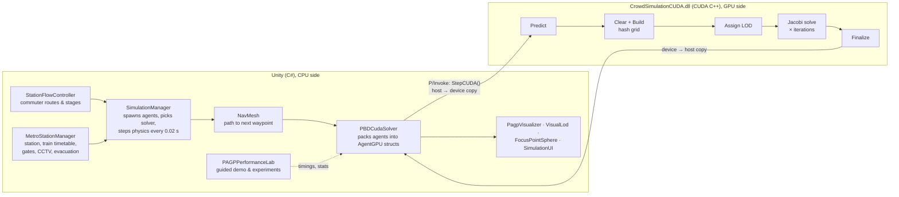

# Interaction-Aware Adaptive GPU Crowd Simulation

### Metro Station Digital Twin (PAGP × CGVR)

A real-time simulation of commuters moving through a metro station. Every commuter's movement is computed **in parallel on an NVIDIA GPU** with a hand-written **CUDA** Position-Based Dynamics solver, and shown in a **Unity 3D** station: fare gates, a platform, a timetabled train, CCTV cameras and an evacuation drill.

The project combines two subjects:

| | Subject | What this project contributes |
|---|---|---|
| **PAGP** | Parallel programming and computer architecture | CUDA kernels, GPU spatial hashing, a parallel Jacobi PBD solver, adaptive simulation LOD, AoS vs SoA memory layout, measured with CUDA events |
| **CGVR** | Computer graphics and virtual reality | Station digital twin, animated characters, CCTV and eye-level (VR) cameras, foveated animation, render LOD, in-scene visual overlays |

**Problem.** Station operators need to see how crowds behave at bottlenecks (fare gates, platform doors) and during evacuations, in real time and at crowd sizes where a CPU becomes too slow. A GPU solver can simulate thousands of people per frame, but only if the work is organised for parallel hardware. This project builds that solver and measures each design decision.

---

## Contents

1. [Quick start](#1-quick-start)
2. [What you see](#2-what-you-see)
3. [Project flow](#3-project-flow)
4. [The PAGP concepts](#4-the-pagp-concepts)
5. [The CGVR concepts](#5-the-cgvr-concepts)
6. [The 60-second guided demo](#6-the-60-second-guided-demo)
7. [Results](#7-results)
8. [Reproducing the benchmarks](#8-reproducing-the-benchmarks)
9. [Repository layout and key files](#9-repository-layout-and-key-files)
10. [Limitations and future work](#10-limitations-and-future-work)

---

## 1. Quick start

**Requirements**

| | Version used |
|---|---|
| OS | Windows 10/11, 64-bit |
| Unity | **2022.3.62f3** (built-in render pipeline) |
| GPU | NVIDIA with CUDA support (tested: RTX 2050 Laptop, `sm_86`, 4 GB). The shipped DLL is built for `sm_86`; for other GPUs rebuild it with `set CUDA_ARCH=sm_XX` + `build.bat install` (§8). |
| To rebuild the CUDA plugin (optional) | CUDA Toolkit 13.5 + Visual Studio C++ build tools (tested VS 18 / MSVC v145) |

**Run it**

1. Open the **`CSIM/`** folder in Unity Hub (not the repository root).
2. Open the scene `Assets/Scenes/414/Steering Demo.unity`.
3. Press **Play**. Commuters start their commute through the station.
4. In the right-hand panel, click **▶ RUN GUIDED DEMO**, or in the menu bar choose **Tools → PAGP → Run Guided Demo**.
5. After 60 seconds the **Results** tab opens with all five concepts measured and explained.

The CUDA plugin ships precompiled at `CSIM/Assets/Plugins/x86_64/CrowdSimulationCUDA.dll`, so you don't need the CUDA Toolkit just to run the project. It works in Editor Play Mode on Windows x64.

---

## 2. What you see

### The station (Metro Commute scenario, the default)

300 commuters walk at a realistic **1.4 m/s** (with ±15% individual variation) through a full passenger cycle:

```text
street stairs ──► ticket machines / concourse ──► fare gates (tap card, ~0.6 s)
      ▲                                                  │
      │                                                  ▼
 exit gates ◄── alight when doors open ◄── TRAIN ◄── wait on platform ──► board
```

* **Fare gates:** 6 cabinets form 3 entry lanes and 2 exit lanes. Commuters slow down while tapping their card, which creates realistic queues.
* **Train timetable:** a 3-car train brakes into the platform, the **platform screen doors slide open** for about 11 s (door lamps turn green), close, and the train departs. The next train follows a few seconds later.
* **Evacuation drill:** an alarm light pulses and every commuter re-routes to the nearest emergency exit in the end walls.
* **Signage:** ENTRY / EXIT ONLY / PLATFORM 1 / STREET / TICKETS / EXIT, so the scene explains itself.

The other scenarios in the panel (Open Concourse, Circle, Crossing, Corridor, Single Gap, Double Gap, Lane Merge) are **synthetic stress tests** for the solvers.

### The screen

```text
┌─────────────────────┐   ┌──────── caption bar ────────┐   ┌──────────────────────┐
│ OPERATIONS CONTROL  │   │ plain-English sentence about│   │  PAGP PERFORMANCE LAB│
│ CENTER (left)       │   │ what is on screen + legend  │   │  (right)             │
│ • solver & scenario │   └─────────────────────────────┘   │ ▶ Run Guided Demo    │
│ • tuning sliders    │                                     │ 5 experiment buttons │
│ • station ops:      │                                     │ Tabs: Concepts /     │
│   CCTV, train,      │          3D station view            │   Live Demo / Results│
│   evacuation,       │                                     │                      │
│   overlays          │                                     │                      │
└─────────────────────┘                                     └──────────────────────┘
```

**Overlays** (Station Ops tab) make the invisible GPU work visible:

| Overlay | Concept | What it shows |
|---|---|---|
| **Hash-Grid Heat Map** | PAGP: spatial hashing | The floor is tiled with the GPU's 4 m hash cells, coloured by how many commuters are inside (blue = few → red = crowded). |
| **LOD Rings** | PAGP: adaptive simulation LOD | A ring under each commuter shows the detail level the GPU chose this step: **green High, amber Medium, blue Low**. |
| **Foveated Animation** | CGVR: foveated rendering | A sphere per commuter shows how often its animation is updated: full rate at the centre of view, fewer updates further out, paused far away. |

**Keyboard (foveated animation):** `D` toggles the spheres, `Q`/`W` change the foveation strength, `A`/`S` change the size of the full-rate area.

---

## 3. Project flow

### 3.1 Architecture



### 3.2 What happens in one physics step (every 0.02 s)

| # | Where | Step |
|---|---|---|
| 1 | C# `StationFlowController` | Each commuter has a stage (to gate → through gate → to platform spot → waiting → to door → on train → to exit → to street). Reaching a target moves it to the next stage. |
| 2 | C# NavMesh | The commuter's path gives its next corner; the **preferred velocity** points there at its walking speed, slowing smoothly near its destination so waiting commuters stand still. |
| 3 | C# `PBDCudaSolver` | All agents are packed into an array of 80-byte `AgentGPU` structs, along with camera frustum planes, focus point, LOD weights and solver parameters. |
| 4 | GPU: **H2D copy** | The array is copied to GPU memory over PCIe. |
| 5 | GPU: `KernelPredict` | One thread per agent: blend velocity toward the preferred velocity and predict a new position. |
| 6 | GPU: `KernelClearHashGrid`, `KernelHashAgents` | Each agent is placed into a 4 m grid cell, hashed into one of 8,192 buckets (atomic inserts). |
| 7 | GPU: `KernelAssignLOD` | Each agent gets an importance score from 4 factors and a tier: High / Medium / Low. |
| 8 | GPU: `KernelSolveConstraints` + `KernelApplyCorrections` | Repeated *k* times (Jacobi iterations). Each thread looks only at agents in the 3×3 surrounding cells, computes position corrections, and all corrections are applied together. |
| 9 | GPU: `KernelFinalize` | Velocity = corrected displacement ÷ dt. |
| 10 | GPU: **D2H copy** | Results are copied back; C# moves each character and drives its walk/idle animation from the real velocity. |

Every GPU stage is timed with **CUDA events**, which is how the live results are measured.

### 3.3 Solver modes (for comparison)

| Mode | Runs on | Purpose |
|---|---|---|
| Force / Force Jobs | CPU (1 thread / Unity Jobs + Burst) | Classic social-force baseline |
| PBD / PBD Jobs | CPU (1 thread / Jobs + Burst) | Same PBD algorithm on the CPU |
| CLOD (+ Culling) | CPU Jobs | Distance-based LOD and frustum culling on the CPU |
| PBD Compute | GPU compute shader | Unity-native GPU path |
| **CUDA (GPU)** | **Native CUDA plugin** | **The main solver, used by the demo and experiments** |

---

## 4. The PAGP concepts

### Concept 1: CUDA data parallelism

**Idea.** Crowd simulation is *data-parallel*: every commuter runs the same computation on different data. CUDA maps **one thread to one commuter** (blocks of 64 threads), so thousands of commuters are processed at the same time.

**In this project.** Five kernels run in sequence each step (§3.2). The host code (`CrowdPlugin.cu`) allocates device memory once for up to 10,000 agents, copies the crowd in and out each step, and records CUDA events around every stage.

**Key insight: transfer cost.** The GPU doesn't win for free. At 300 commuters about **46% of the step is PCIe copying**, and at 500 agents an optimised CPU is still faster. As the crowd grows, computation dominates and the GPU pulls ahead (see §7). This crossover is the central lesson of GPU offloading.

### Concept 2: Spatial hashing (from O(N²) to roughly O(N·k))

**Problem.** Checking every pair of commuters for collisions needs N(N−1) tests: 89,700 for 300 people, about 25 million for 5,000.

**Solution.** The floor is divided into 4 m cells. Each agent computes its cell, hashes it into one of **8,192 buckets** (up to 16 entries per bucket, with an overflow area for dense spots) using atomic operations, and then only tests agents in its own cell and the **8 neighbouring cells**.

**Why 4 m:** it is larger than the interaction distance, so no real neighbour is ever more than one cell away.

**See it:** the *Hash-Grid Heat Map* overlay. Red tiles appear at the fare gates and platform doors, where the solver does the most work.

### Concept 3: Position-Based Dynamics with a Jacobi solver

**Idea.** Instead of computing forces, PBD (Weiss et al., 2019) **predicts** where each person wants to go and then **moves positions just enough to satisfy constraints**:
* **Short-range constraint:** two people may not overlap (radius 0.5 m), with static/kinetic friction so they don't slide unrealistically.
* **Long-range (anticipatory) constraint:** a High-LOD agent anticipates a collision up to 2 s ahead and steers early.

**Why Jacobi.** In the classic Gauss–Seidel form each correction uses the previous one, which is sequential. In the **Jacobi** form every thread computes its correction from the same old positions, writes it to a separate buffer, and all corrections are applied together. That avoids write races and makes the solver fully parallel. The price is that Jacobi converges more slowly per iteration, so the solver repeats it *k* times.

**Trade-off.** More iterations leave less overlap but cost more GPU time. The demo measures exactly this on a frozen snapshot of the live crowd.

### Concept 4: Four-factor adaptive simulation LOD

**Idea.** Not every commuter needs the same accuracy. Each agent gets an importance score:

```text
importance = 0.30 · distance score    (closer to the viewer = more important)
           + 0.25 · visibility score  (inside the camera frustum = important)
           + 0.20 · interaction score (currently in contact with others)
           + 0.25 · density score     (standing in a crowded cell)
```

| Tier | Importance | Solver work per step |
|---|---|---|
| **High** (green) | ≥ 0.60 | all *k* iterations + anticipatory constraint |
| **Medium** (amber) | ≥ 0.30 | ⌈k/2⌉ iterations |
| **Low** (blue) | < 0.30 | 1 iteration, every 4th step |

**Why four factors.** Distance alone would demote a crowded but distant bottleneck where collisions really happen. The interaction and density terms keep those agents accurate, while people behind the viewer or in empty areas are solved less often.

**Ablation.** The demo turns the factors on one at a time (A: distance → B: + visibility → C: + interaction → D: all four) and compares each against a **no-LOD baseline** where everyone is High.

### Concept 5: Memory layout, AoS vs SoA

**Array of Structures (AoS):** `AgentGPU[i]` holds all of agent *i*'s fields together (80 bytes). When 32 threads of a warp each read `position`, their loads are 80 bytes apart: **strided**, so many memory transactions are wasted.

**Structure of Arrays (SoA):** `positions[]`, `velocities[]`, ... are each stored contiguously. Neighbouring threads read neighbouring floats, so the 32 loads **coalesce** into a few 128-byte transactions.

The plugin contains both versions of the solve kernel (`KernelSolveConstraints` and `KernelSolveConstraintsSoA`) and times them on the same crowd.

---

## 5. The CGVR concepts

| Concept | Where | What it does |
|---|---|---|
| **Digital twin modelling** | `MetroStationManager`, `StationLayout` | The station is generated procedurally from one shared layout, so the visible geometry, the walkable NavMesh obstacles and the commuter routes always line up. |
| **Animated characters** | `PBDAgent`, Animator | Each commuter switches between idle and walking. The walk cycle's playback speed follows the solver's real velocity, so feet don't slide. |
| **Camera system** | `MetroStationManager` | Four CCTV presets (overview, fare gates, platform, **commuter eye level 1.7 m**, the VR viewpoint) with smooth exponential camera glides instead of cuts. |
| **Foveated animation** | `FocusPointSphere` | Animation update rate depends on how far a character is from the centre of view, as in foveated rendering for VR headsets. Supports HTC Vive SRanipal eye tracking (`useVR`). |
| **Render LOD** | `PBDCudaVisualLodController` | Distance tiers (near < 12 m, mid < 26 m, far) lower animation rates (10 fps mid, 3 fps far), simplify far meshes, drop distant shadows and hide off-screen characters. Rendering only; the physics is unaffected. |
| **Visual explanation** | `PagpVisualizer`, caption bar, `StationText3D.shader` | Heat-map tiles and LOD rings drawn with one shared quad mesh and five shared materials (cheap to render); a depth-tested text shader so signs read correctly. |
| **Performance-aware lighting** | `MetroStationManager` | Few lights, vertex-lit fill lights and no dynamic shadows on station props, so 300 skinned characters stay at about 90 FPS. |

---

## 6. The 60-second guided demo

One continuous rush-hour commute: the crowd is spawned once and never reset. Every 12 seconds the camera glides to a new view and one concept is measured **live on the GPU**.

| Time | Camera | On screen | Measured |
|---|---|---|---|
| 0–12 s | Station overview | Commuters flow from street to platform | CUDA step time: kernels vs PCIe copies |
| 12–24 s | Station overview | **Hash-grid heat map** | Brute-force pairs vs real 3×3-cell candidate pairs |
| 24–36 s | Fare gates | Queues forming in the gate lanes | Same crowd snapshot solved with 1/2/4/8 Jacobi iterations |
| 36–48 s | Commuter eye level (VR) | **LOD rings** | LOD ablation A→D vs no-LOD baseline |
| 48–60 s | Station overview | **Evacuation drill** | AoS vs SoA solve kernel |

Then the **Results** tab opens and a CSV is saved to `%USERPROFILE%\AppData\LocalLow\cmput414\CSIM\PAGP_GuidedDemo_<timestamp>.csv`.

The five **experiment buttons** run longer, standalone versions of each measurement (for example a sweep over 250 / 500 / 1,000 agents) and also export CSVs.

---

## 7. Results

### 7.1 Native benchmark (reproducible, RTX 2050 Laptop GPU)

`NativeCUDA\build.bat bench`: CUDA 13.5, `-O3`, `sm_86`, 2 warm-up + **20 measured trials**, fixed seed. Raw data: [`BenchmarkResults/Phase3_Rerun_2026-11-27/`](BenchmarkResults/Phase3_Rerun_2026-11-27/README.md).

**Scalability (Experiment A)**

| Agents | CPU brute force | CPU spatial hash | **CUDA full step** | CUDA vs CPU hash | CUDA vs brute force |
|---:|---:|---:|---:|---:|---:|
| 500 | 0.80 ms | 0.20 ms | 0.46 ms | 0.4× (CPU wins) | 1.8× |
| 1,000 | 3.08 ms | 0.60 ms | 0.59 ms | 1.0× (break-even) | 5.3× |
| 2,500 | 20.90 ms | 3.15 ms | 1.29 ms | 2.4× | 16× |
| 5,000 | 85.80 ms | 11.01 ms | **2.28 ms** | **4.8×** | **38×** |

From 500 to 5,000 agents the CPU brute force time grows **×107** (quadratic), while CUDA grows only **×5** (roughly linear).

**Pipeline breakdown at 5,000 agents (Experiment B):** solve 1.96 ms of 2.28 ms; PCIe copies 0.22 ms (10%); hash + LOD + predict + finalize < 0.1 ms combined.

**Memory layout (Experiment C):** SoA solve kernel **2.2× (500) to 2.9× (2,500–5,000) faster** than AoS.

**PBD convergence (Experiment D, 2,500 agents):** average overlap 0.331 m → 0.208 m from 1 → 16 iterations; kernel time 0.29 → 4.84 ms (linear).

**LOD with a camera (Experiment E2, 2,500 agents)**

| Configuration | Agent-solves per step | vs no LOD | Solve time | vs no LOD |
|---|---:|---:|---:|---:|
| No LOD (all High) | 7,500 | | 0.892 ms | |
| A: Distance only | 3,210 | −57% | 0.635 ms | −29% |
| B: + Visibility | 3,668 | −51% | 0.739 ms | −17% |
| C: + Interaction | 3,366 | −55% | 0.691 ms | −22% |
| **D: Full 4-factor** | **5,267** | **−30%** | **0.763 ms** | **−14%** |

Distance-only saves the most work but demotes crowded agents; the full model deliberately spends more on agents that are in contact or in dense spots. Experiment E (no camera, everyone visible) is kept in the CSVs for transparency: there almost everyone is High and LOD cannot help.

### 7.2 Live results in the Unity demo (300 commuters, Metro Commute)

| Concept | Result |
|---|---|
| CUDA step | 1.5 ms per step at ~90 FPS; ~46% of it is PCIe transfer at this size |
| Spatial hash | 89,700 brute-force pairs → 11,892 grid candidates: **86.7% pruned**, no bucket overflow |
| PBD convergence | Same snapshot, 1 → 8 iterations: total overlap **−24%**, worst overlap **−45%** |
| 4-factor LOD | **17%** less solver work than all-High (eye-level view) |
| AoS vs SoA | **2.4×** faster with SoA |

Live numbers vary a little from run to run because the crowd moves; each run's CSV records the exact values.

---

## 8. Reproducing the benchmarks

```bat
cd NativeCUDA
build.bat            :: build the plugin DLL and benchmark program into NativeCUDA\build\
build.bat bench      :: build, then run experiments A–E2 (~25 s); CSVs in NativeCUDA\build\
build.bat install    :: build, then copy the DLL into the Unity project (close Unity first)
```

The script finds Visual Studio automatically. For a different GPU, run `set CUDA_ARCH=sm_75` (or your architecture) first. Details: [`NativeCUDA/README.md`](NativeCUDA/README.md).

---

## 9. Repository layout and key files

```text
CSIM/                              Unity project (open this folder in Unity)
  Assets/Scenes/414/Steering Demo.unity   main scene
  Assets/Scripts/
    SimulationManager.cs           spawns agents, selects solver, scenarios, physics loop
    SimulationUI.cs                control panels, tabs, caption bar, overlay buttons
    PAGPPerformanceLab.cs          guided demo + 5 experiments + CSV export
    PagpVisualizer.cs              hash-grid heat map and LOD rings
    PBDCudaVisualLodController.cs  render LOD (animation rate, shadows, culling)
    focus_point_sphere.cs          foveated animation
    Solvers/PBDCudaSolver.cs       C# ↔ CUDA bridge (P/Invoke, AgentGPU struct)
    Solvers/*.cs                   CPU / Jobs / compute-shader comparison solvers
    Agents/PBDAgent.cs             character movement and animation
    Metro/MetroStationManager.cs   station builder, train timetable, CCTV, evacuation
    Metro/StationFlowController.cs commuter journey stages
    Metro/StationLayout.cs         shared station dimensions
  Assets/Plugins/x86_64/CrowdSimulationCUDA.dll   compiled CUDA plugin
  Assets/Editor/PagpDemoMenu.cs    Tools → PAGP menu
  Assets/Resources/Shaders/StationText3D.shader   depth-tested sign text
NativeCUDA/
  CrowdKernels.cu                  all CUDA kernels
  CrowdPlugin.cu                   host code: memory, launches, timing, exported API
  CrowdCommon.h                    shared structs (must match PBDCudaSolver.cs)
  run_phase3.cpp                   benchmark harness (experiments A–E2)
  build.bat                        build / benchmark / install script
BenchmarkResults/                  archived CSVs and reports (latest: Phase3_Rerun_2026-11-27)
```

---

## 10. Limitations and future work

**Limitations**
* **Small crowds:** below ~1,000 agents the optimised CPU matches or beats the GPU, because data transfer and kernel-launch overhead dominate.
* **Moderate live LOD savings:** 14–30% in solver time and work. Threads skipped by LOD sit idle inside warps that still run, so time savings are smaller than work savings.
* **Extreme densities:** very dense clusters can exceed a hash bucket's capacity. An overflow area handles moderate cases, but correctness is not claimed for arbitrary densities.
* **Visual fidelity:** the station is built from simple geometry with a single character model; not tested on a physical VR headset.
* **Historical data:** older runs are kept unchanged in `BenchmarkResults/` (`Phase3_Final`, `Earlier_Experiments`). They came from a different build and are not comparable with the reproducible re-run.

**Future work**
* Keep agent state resident on the GPU between steps, copying only render data, to remove most PCIe cost.
* Sort agents by cell (or by LOD tier) so warps do uniform work and LOD time savings approach the work savings.
* Use the SoA layout in the live pipeline, not only in the benchmark kernel.
* Add textures, more character models and baked lighting; test with an eye-tracked headset.

**Licence:** no licence file is included yet; add one before public distribution.
